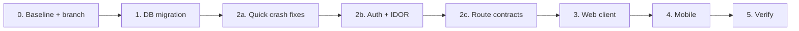

# Implementation Plan: Spatially Remediation

Source of truth for findings: [REMEDIATION_SPECIFICATION.md](REMEDIATION_SPECIFICATION.md)

## Approach
Fix in dependency order (DB, server, web, mobile), one reviewable batch per step, verifying after each. Baseline to protect: pytest 12/12, `vite build` succeeds.

## Step 0 - Setup
- Create branch `fix/remediation` off `test` (tree was clean).
- Record baseline: `pytest`, `npm run lint` (75 warnings), `npm run build`.

## Step 1 - Database (T-1.1)
- Add `supabase/migrations/20261024_phase8c_reconcile_web_tables.sql`: 4 missing tables (+RLS), widen `crowd_zone_snapshots_source_check`, add `resolution_notes` / `due_at`.
- Idempotent (`IF NOT EXISTS`, `DROP CONSTRAINT IF EXISTS`).
- Mark `server/database/*.sql` deprecated (header comment only).
- Verify against a local/dev Supabase, never prod first.

## Step 2a - Quick crash fixes (T-2.1, 2.2, 2.5, 2.6)
| Fix | File |
|---|---|
| `NameError: i` line 127 | `server/data/simulate_crowd.py` |
| `source` to `ble_telemetry` (lines 460, 564) | `server/data/simulate_volunteers.py` |
| `utcnow()` to `now(timezone.utc)` | `server/services/crowd_prediction.py` |
| `KeyError: 'user_id'` | `server/routes/volunteers.py` |
| Remove V1/V2 ID validator, accept UUID | `server/models.py` |

Write a failing regression test first for each (tdd skill).

## Step 2b - Auth and IDOR (T-2.3, part of 2.4) - highest security value
1. `middleware/auth.py`: role from `profiles` only; default `"user"`; normalize attendee/user.
2. Shared helper to resolve a row's `event_id` + `verify_event_ownership`; apply to PUT/DELETE for incidents, tasks, zones, booths, sessions and `venue_map.py`.
3. `main.py`: replace reflected `Origin` with an env allow-list.
4. Tests: non-owner gets 403; missing profile gives role `user`.

## Step 2c - Route contract fixes (T-2.4)
Each with a test against a mocked Supabase client: comms (`body`, `sender_role`, enums), incidents (`status='open'`, `venue_zone_name`, accept `assigned_to`), tasks (supervisor fields, status `assigned`), zones ordering, duplicate `/assistance` route, `/shift-handoffs` alias, crowd payload `zone_id`.

## Step 3 - Web client (T-3.x)
Order: `AuthContext` (user_type, `updateProfile`, `user_id`), Profile/Forgot/Reset/Verify via Supabase SDK, ID-key bugs (InviteVolunteer, VolunteerPlacer), payload alignment (Incidents, Analytics CSV, Crowd, Volunteers, EventLogs, Comms), `VenueMap` race + polling, `validators.formatTime`.
Verify: `npm run lint`, `npm run build`, manual run via `start.bat`.

## Step 4 - Mobile (T-4.x)
`supabase_config.dart.example` x2, `LostFoundScreen` loop, ticket claim `user_id`, `flushPendingMessages()`, then BLE rotation singleton (largest; needs a physical device).
Verify: `flutter analyze` + `flutter test`.

## Step 5 - Verification (T-5.1)
pytest, lint, build, both simulators, and a smoke test that an attendee signup cannot reach organizer routes.

## Risks
- BLE refactor and RLS policies cannot be fully tested without a device / live Supabase.
- Removing the V1/V2 validator or changing role defaults may break existing demo data.
- Role default change can lock out organizers lacking a `profiles` row (add backfill).

## Open questions
1. Is there a dev Supabase project to apply the migration to, or should I only write the SQL?
2. Do all existing organizers have a `profiles.role` row? If not, add a backfill to the migration.
3. Scope: everything, or Steps 0-2b (crashes + security) first?
4. Fix the 75 lint warnings, or out of scope?
