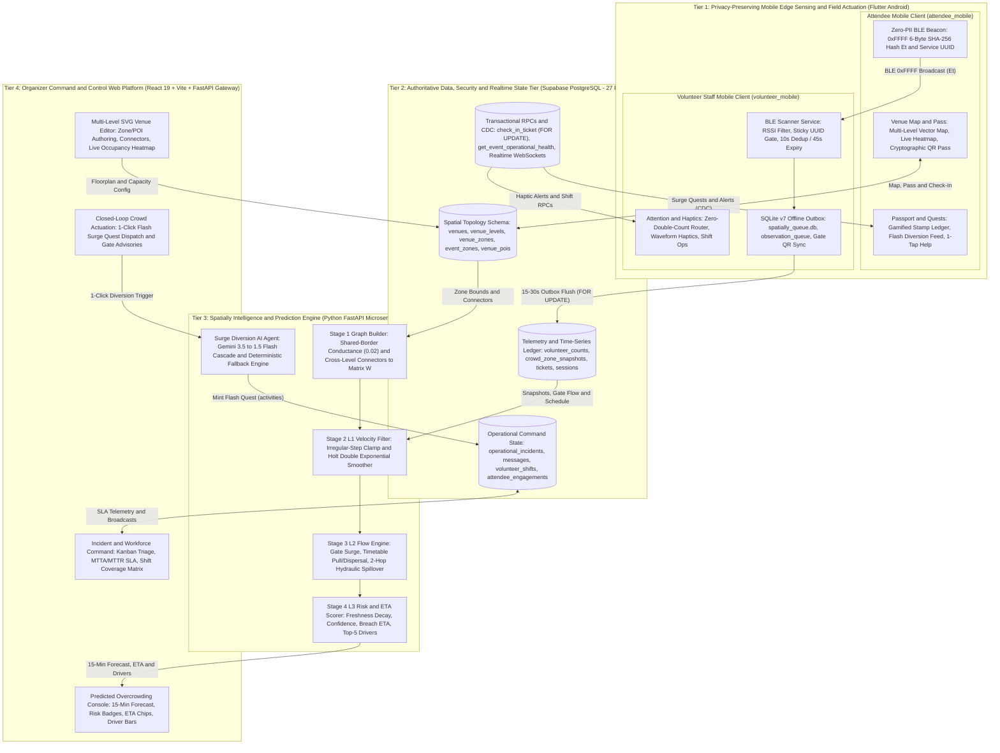
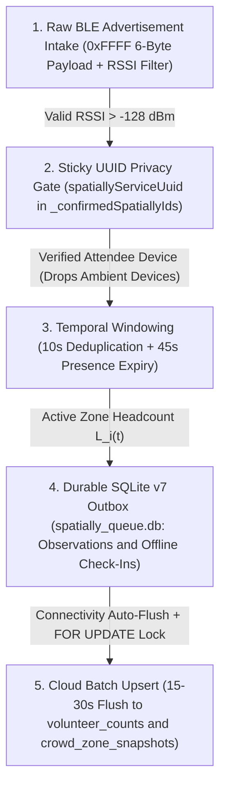
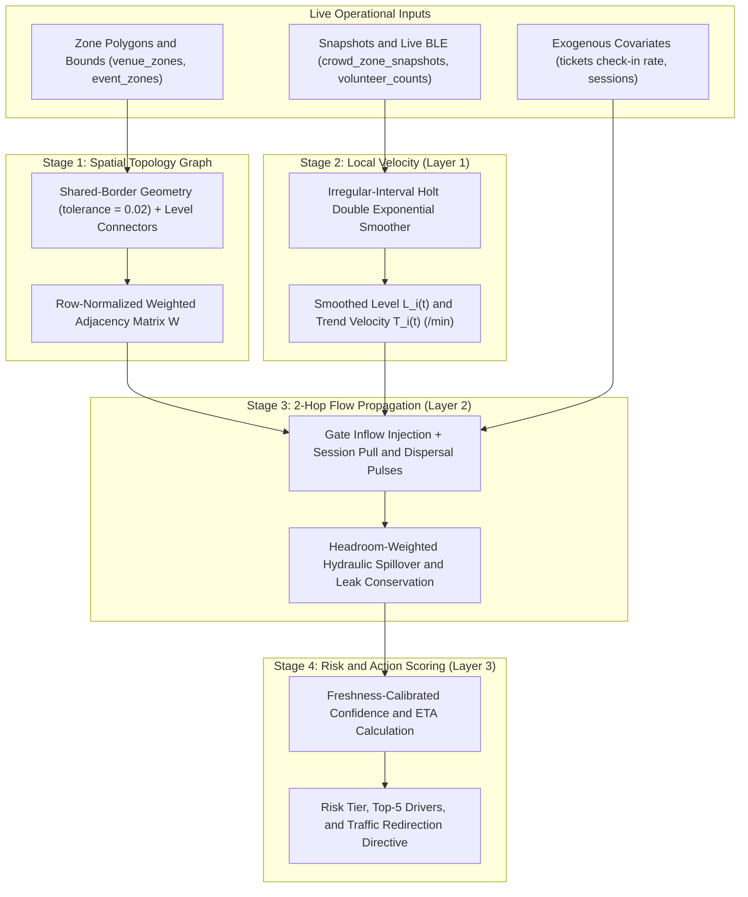
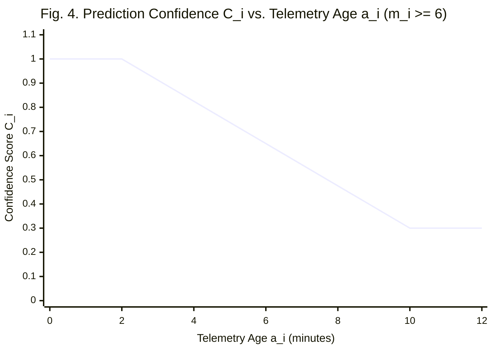
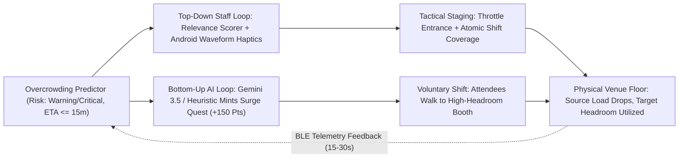
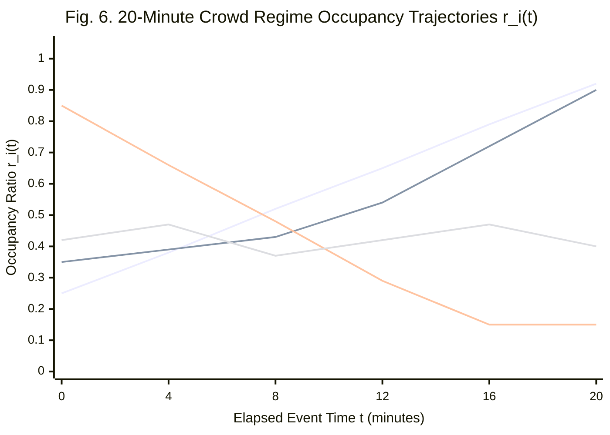
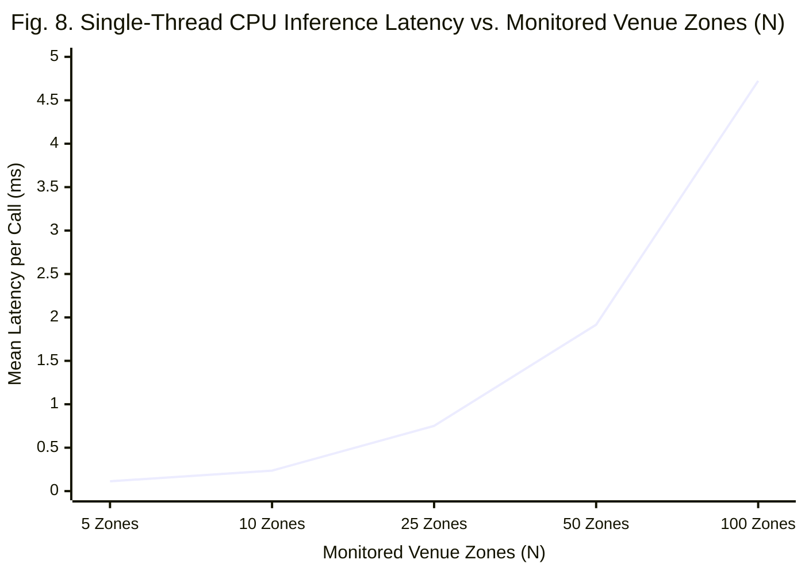

# Spatially: Privacy-Preserving BLE Telemetry and Macroscopic Graph Forecasting for Venue Crowd Management

**Aryan Verma, Blaise Rodrigues, Daksh Thakar, Devansh Nayak, and Prof. Ankita Amburle**  
*Computer Engineering Department*  
*Fr. Conceicao Rodrigues College of Engineering*  
*Emails: aryanverma1750@gmail.com, blaiserods26@gmail.com, dakshthakkar296@gmail.com, devanshnayak2006@gmail.com, ankita.amburle@fragnel.edu.in*

---

***Abstract*—Managing crowd safety across large-scale indoor and multi-level venues remains a critical public safety challenge. Conventional monitoring systems rely either on privacy-invasive camera or Media Access Control (MAC) surveillance, or on deep learning models that suffer from cold-start failures in temporary venues lacking historical training data. Furthermore, existing event dashboards operate reactively and lack closed-loop mechanisms to redistribute foot traffic. This paper presents *Spatially*, an end-to-end, privacy-preserving event intelligence and crowd coordination platform uniting Attendee Mobile, Volunteer Mobile, and Organizer Web Command surfaces. Spatially introduces three technical contributions: (1) a Bluetooth Low Energy (BLE) telemetry pipeline free of personally identifiable information (PII), using rotating 6-byte SHA-256 ephemeral identifiers, sticky service-UUID filtering, and an offline-resilient SQLite outbox; (2) a training-free, three-layer macroscopic overcrowding predictor combining irregular-interval Holt exponential smoothing, floorplan-derived topology graphs, mass-conserving hydraulic spillover, and timetable-driven session surges; and (3) a closed-loop mitigation architecture pairing volunteer waveform haptics with generative AI *Flash Surge Diversion Quests* to incentivize voluntary attendee dispersal. Evaluation across 205 mobile tests, Android hardware trials, and multi-scale benchmarks demonstrates 25-zone, 15 min horizon inference in 0.751 ms (4.724 ms for 100 zones), exact mass conservation ($< 10^{-6}$ residual), and 12.3 min early-warning lead times.**

***Keywords*—Bluetooth Low Energy, Crowd Monitoring, Data Privacy, Exponential Smoothing, Graph Theory, Indoor Environments, Pedestrian Traffic, Public Safety.**

---

## I. INTRODUCTION

Large-scale physical gatherings—such as technical conferences, stadium exhibitions, multi-track conventions, and music festivals—transform constrained architectural spaces into high-density, rapidly evolving pedestrian networks. As global urbanization and event attendance intensify, preventing localized overcrowding and crowd-crush incidents has become a paramount public safety priority [1], [2]. Forensic analyses of recent high-density pedestrian disasters, including the 2022 Itaewon crowd crush, reveal that fatal congestion rarely occurs instantaneously; rather, it is preceded by a 15-to-30-minute accumulation window during which localized pedestrian inflows consistently exceed structural egress capacities [2], [3]. Consequently, shifting event operations from retrospective observation to proactive, short-horizon anticipation (5 to 20 minutes ahead) is essential to provide safety directors and on-ground staff with the operational buffer required to throttle gate admissions, stage personnel, and redirect foot traffic [4], [5].

Despite extensive research in pedestrian dynamics and indoor positioning, deploying real-time crowd intelligence in temporary or reconfigurable event venues presents four fundamental systems engineering challenges:

1. **The Privacy-Surveillance Dichotomy:** Camera-based computer vision (CV) counting networks and passive Wi-Fi/Bluetooth Media Access Control (MAC) sniffers expose attendees to persistent biometric or hardware-level trajectory tracking, violating modern data protection frameworks and eroding user trust [6], [7]. Conversely, modern mobile operating systems randomize hardware MAC addresses at unpredictable intervals, corrupting naive scanner headcounts via double-counting or premature expiry.
2. **The Cold-Start and Edge Compute Bottleneck:** Deep spatio-temporal neural networks (such as ConvLSTMs and Graph Attention Networks) require months of historical sensor traces to learn venue-specific flow transitions [8], [9]. However, conventions and pop-up exhibitions feature bespoke booth layouts, temporary partitions, and one-off session timetables for which zero historical training data exist [4]. Moreover, parameter-heavy neural models impose prohibitive inference latency and memory overhead on edge and mid-tier cloud infrastructure [10].
3. **Intermittent Venue Connectivity:** High attendee density saturates local cellular towers and venue Wi-Fi access points. Operational telemetry, QR ticket admissions, and incident dispatches that rely on synchronous cloud round-trips suffer from dropped packets, race conditions, and inconsistent state during peak ingress surges.
4. **Open-Loop Operational Silos:** Traditional crowd monitoring dashboards terminate at passive visualization [5]. Even when an organizer observes an impending bottleneck on a heatmap, translating that insight into physical crowd dispersal requires slow, manual radio coordination and lacks direct behavioral incentives for attendees.

To address these challenges, this paper presents **Spatially**, a unified, privacy-preserving event operations and spatial crowd intelligence platform. Spatially bridges three distinct client and control tiers over a shared, Row-Level Security (RLS)-hardened PostgreSQL real-time backend: (1) an *Attendee Mobile Application* (`attendee_mobile`), (2) a *Volunteer Staff Mobile Application* (`volunteer_mobile`), and (3) an *Organizer Command Web Platform and Intelligence Engine* (`client/` and `server/`).

Rather than tracking individual attendee trajectories, Spatially enforces privacy at the physical link layer. Attendee devices broadcast a custom BLE service UUID accompanied by a rotating 6-byte SHA-256 ephemeral payload inside the `0xFFFF` manufacturer data frame. On-ground volunteers act as mobile and stationary spatial sensors whose smartphones deduplicate, filter, and buffer proximity observations into a local SQLite write-behind outbox (`spatially_queue.db`) before flushing aggregated zone headcounts (`volunteer_counts`) and time-series snapshots (`crowd_zone_snapshots`) to the cloud.

On the backend, Spatially replaces black-box machine learning with a transparent, mathematically rigorous **Three-Layer Macroscopic Overcrowding Prediction Engine**. Grounded in continuum fluid mechanics [11], [12] and network flow conservation [13], the predictor automatically constructs a weighted spatial adjacency graph from normalized 2D floorplan polygons (`venue_zones.bounds`) and multi-floor vertical connectors (`venue_pois`). It then estimates per-zone velocity via irregular-interval Holt double exponential smoothing (Layer 1), propagates hydraulic pressure spillovers, gate check-in inflows, and timetable-driven session surges across a two-hop neighborhood while strictly conserving pedestrian mass (Layer 2), and synthesizes data freshness and sample density into calibrated risk tiers (`normal`, `watch`, `warning`, `critical`), estimated time-to-breach (ETA), explainable causal drivers, and topological mitigation actions (Layer 3). Finally, Spatially closes the control loop via two complementary actuation mechanisms: deterministic relevance-scored staff routing with custom Android waveform haptics, and an LLM-assisted (with deterministic heuristic fallback) **Surge Diversion Quest Agent** that dynamically mints bonus-point gamified quests directing attendees from congested zones toward underutilized sponsor stalls.

### Main Contributions
The primary contributions of this work are summarized as follows:
- **A Zero-PII, Offline-Resilient BLE Crowd Sensing Architecture:** We design and implement a cross-layer mobile telemetry protocol combining rotating 6-byte SHA-256 ephemeral BLE advertising, sticky UUID classification to overcome Android scan-response fragmentation, a 10-second deduplication / 45-second expiry window, and a durable SQLite v7 write-behind outbox with PostgreSQL `FOR UPDATE` atomic ticket reconciliation (Section III).
- **A Training-Free, Mass-Conserving Macroscopic Graph Predictor:** We formulate a three-layer deterministic forecasting algorithm that couples irregular-interval Holt linear smoothing with boundary-derived zone graphs, capacity-headroom-weighted hydraulic spillover, and exogenous session schedule covariance, achieving sub-millisecond inference without historical training data (Section IV).
- **Closed-Loop Socio-Technical Crowd Actuation:** We introduce a dual-channel mitigation paradigm combining a zero-double-counting volunteer attention engine (featuring pocket-friendly Android haptics and atomic shift/coverage state machines) with a generative AI/heuristic gamification agent that incentivizes voluntary crowd dispersion via time-bounded *Flash Surge Quests* (Section V).
- **Comprehensive Empirical & Hardware Validation:** We evaluate Spatially across 205 automated mobile unit/integration tests, physical Android hardware field trials (Nothing Phone A059P), and multi-scale simulation benchmarks, demonstrating $O(V^2 + H \cdot E)$ sub-5 ms scalability up to 100 zones, exact pedestrian mass conservation, and 12.3-minute early-warning lead times on multi-hop keynote dispersal bottlenecks (Section VI).

The remainder of this paper is organized as follows. Section II reviews related literature in crowd forecasting, spatial topology modeling, BLE telemetry, and crowd redirection. Section III details the overall Spatially system architecture and privacy-preserving mobile sensing pipeline. Section IV presents the mathematical formulation of the three-layer overcrowding prediction engine. Section V describes the closed-loop operational subsystems and gamified surge diversion mechanism. Section VI reports experimental evaluations, ablation studies, and computational complexity benchmarks. Section VII discusses operational implications and threats to validity, and Section VIII concludes the paper.

---

## II. RELATED WORK

To position Spatially within the broader landscape of ubiquitous computing, pedestrian dynamics, and intelligent transportation systems, we organize prior literature into four thematic pillars. Table I summarizes how Spatially compares against representative state-of-the-art frameworks across key architectural dimensions.

**TABLE I: COMPARISON OF SPATIALLY WITH REPRESENTATIVE CROWD MONITORING FRAMEWORKS**

| Study | Sensing | Zero-Training | Graph Flow | Closed-Loop Actuation |
| :--- | :--- | :---: | :---: | :--- |
| **Yasufuku [5]** | Fixed LiDAR | Yes | No | Visual Dashboard |
| **Bohnet [11]** | Camera Grid | No | Continuum PDE | None |
| **Duan [9]** | Cellular Logs | No | Grid CNN | None |
| **CPMS-Net [10]** | RGB Cameras | No | Multi-Scale | None |
| **Daamen [4]** | Sensor Streams | Yes | Corridor Links | Operational Advisory |
| **Jeong [14]** | IoT Beacons | Partial | Grid Twin | Security Alerting |
| **Spatially (Ours)** | **Volunteer BLE + QR** | **Yes** | **2-Hop + Schedule** | **Haptics + AI Quests** |

### A. Short-Term Crowd Forecasting and Operational Dashboards
Conventional event management relies on retrospective occupancy visualization, which Yasufuku and Takahashi [5] demonstrated is insufficient to prevent crush incidents due to the structural lag between control decisions and physical crowd response. Recent work has emphasized short-horizon (5–20 minute) forecasting. Daamen et al. [4] developed a short-term pedestrian forecasting framework for the multi-million-visitor SAIL2025 maritime event, demonstrating that coupling live sensor streams with rapid velocity-correcting filters yields actionable 10–20 minute forecasts without historical training datasets. Similarly, Jeong et al. [14] proposed a two-stage coarse-to-fine digital twin framework for sparse crowd density prediction, proving that partitioning venues into discrete monitored zones provides security personnel with crucial intervention lead times. While [4] and [14] validate short-horizon filtering and zone partitioning, neither integrates automated floorplan boundary graph derivation with closed-loop attendee gamification.

### B. Spatial Graphs, Topology, and Macroscopic Continuum Flow
In dense pedestrian environments, architectural constraints govern movement more strongly than individual psychological preferences. Jang and Kwon [15] established that as crowd density rises, room boundaries, corridors, and vertical connectors dominate flow trajectories. Boomers et al. [16] empirically quantified how narrow bottlenecks and entrance geometries throttle throughput as capacity limits are approached, inducing upstream queuing. To model these effects computationally, Dang et al. [8] surveyed 116 dense crowd simulation models and concluded that microscopic agent-based models (e.g., Social Force Models) suffer from severe calibration fragility and $O(N^2)$ computational bottlenecks in real-time operations, whereas macroscopic continuum and network-flow formulations remain fast and stable.

Within the macroscopic paradigm, Zhou et al. [13] introduced Flow-Through Tensors on computational graphs to enforce node-to-node flow conservation across multi-layer networks. Bohnet and Wehrlein [11] modeled pedestrian mass conservation via continuity partial differential equations, while Edelmann and Goda [12] characterized dense crowds as viscoelastic continuum media that transmit hydraulic pressure outward from congested regions toward lower-density paths. Furthermore, Duan and Sun [9] demonstrated that in stadium and conference environments, scheduled timetable events (session starts and conclusions) act as the dominant exogenous covariate driving sharp spatial density transitions. Spatially synthesizes these findings into a unified, training-free graph propagation engine that combines geometric shared-border weighting [15], [16], mass-conserving hydraulic spillover [11], [12], and timetable-driven dispersal/pull pulses [9].

### C. Privacy-Preserving BLE Telemetry and Edge Constraints
Biometric camera networks and raw MAC address sniffers raise severe privacy concerns under GDPR and modern digital rights standards. Martín-Frechina et al. [6] conducted a systematic review of Wi-Fi and BLE indoor positioning systems, confirming that BLE proximity sensing provides reliable zone-level occupancy telemetry without optical surveillance. However, Shang et al. [10] showed that executing deep perception models on constrained edge devices causes memory exhaustion and inference delays. Spatially overcomes both privacy and hardware constraints by shifting BLE scanning to on-duty volunteer smartphones that filter for a dedicated service UUID (`f47ac10b-58cc-4372-a567-0e02b2c3d479`), extract rotating ephemeral IDs, and aggregate anonymous headcounts before cloud transmission.

### D. Early-Warning Thresholds and Behavioral Crowd Redirection
Analyzing the Itaewon disaster, Liang et al. [2] and Kim et al. [3] formulated early-warning indices based on occupancy ratio thresholds ($0.80$ warning limit, $0.90$ critical limit) combined with rate-of-change and estimated time-to-breach (ETA). However, existing systems treat crowd control strictly as a top-down policing action (e.g., physical barricades). Spatially extends threshold-based alerting [3] by introducing a dual socio-technical actuation layer: top-down supervisor tasking and bottom-up gamified incentive engineering (*Flash Surge Diversion Quests*), turning attendees into cooperative participants in load balancing.

---

## III. SYSTEM ARCHITECTURE AND PRIVACY-PRESERVING TELEMETRY

Spatially is architected as a four-tier cyber-physical system comprising two Flutter Android edge clients (`attendee_mobile` and `volunteer_mobile`), a React 19 / Vite operational command portal (`client/`), a Python FastAPI intelligence and orchestration service (`server/`), and a unified PostgreSQL backend powered by Supabase (`supabase/migrations/`) with Row-Level Security (RLS) and Change Data Capture (CDC) Realtime channels. Fig. 1 illustrates the end-to-end architecture and unidirectional operational data progression.

**Fig. 1.** Two-column system architecture of the Spatially platform across all four operational tiers: (Tier 1) privacy-preserving Flutter Android clients for zero-PII BLE proximity broadcasting, sticky-UUID foreground scanning, offline SQLite v7 outbox queueing, and pocket-friendly haptic routing; (Tier 2) Supabase PostgreSQL data tier with 27 RLS-hardened tables, atomic `FOR UPDATE` ticket RPCs, and Realtime CDC broadcast channels; (Tier 3) Python FastAPI intelligence layer executing the 4-stage macroscopic overcrowding predictor and Gemini 3.5 Flash Lite / deterministic surge diversion agent; and (Tier 4) React 19 Organizer Command Portal for multi-level SVG venue modeling, early-warning risk visualization, and closed-loop crowd actuation.

### A. Ephemeral BLE Advertising and Sticky Scanner Filtering
To eliminate personally identifiable information (PII) from spatial telemetry, Spatially decouples ticket ownership from physical presence sensing. Upon initialization, the Attendee Mobile client generates a local UUID v4 device identifier stored strictly in device-local encrypted preferences (`AttendeeIdentity.deviceId`). During an active event, an Android Foreground Service continuously broadcasts a low-power BLE advertisement carrying the custom Spatially 128-bit Service UUID (`f47ac10b-58cc-4372-a567-0e02b2c3d479`) and a 6-byte manufacturer-specific payload under company identifier `0xFFFF`.

The 6-byte ephemeral identifier $E_t$ (Eq. 1) is derived via a rolling cryptographic hash over the local device UUID $u_d$ and the quantized time epoch $\tau_t = \lfloor t / \Delta_{\mathrm{rot}} \rfloor$:

$$
E_t = \mathrm{Trunc}_{48}\big(\mathrm{SHA\text{-}256}(u_d \parallel \tau_t)\big) \qquad (1)
$$

where $\mathrm{Trunc}_{48}(\cdot)$ extracts the leading 48 bits (12 hexadecimal characters) and $\Delta_{\mathrm{rot}} \in [5, 15]\text{ minutes}$ denotes the ephemeral rotation interval. Because $u_d$ is never transmitted to the server in association with BLE payloads and $E_t$ rotates irreversibly, passive wireless observers cannot reconstruct longitudinal attendee trajectories across an event.

On the receiving end, on-duty volunteers run `BleScannerService` on Android hardware. A practical challenge on Android BLE stacks (observed during hardware validation on Nothing Phone A059P) is **scan-response fragmentation**: the Android Bluetooth controller does not reliably deliver the full 128-bit service UUID list in every secondary scan response packet, and occasionally delivers raw hardware MAC addresses when the `0xFFFF` frame is truncated. To prevent wild oscillations in zone headcounts, `BleScannerService` implements a three-stage state machine:
1. **Signal Sanity and Ephemeral Extraction:** Scan results with invalid RSSI ($\mathrm{RSSI} = -128\text{ dBm}$) are discarded immediately. If the `0xFFFF` manufacturer data frame is present and has an exact length of 6 bytes, the 12-character hex string is extracted as `ephemeralId`; otherwise, the scanner falls back to the OS-rotated remote identifier.
2. **Sticky Service-UUID Classification:** The scanner maintains an in-memory set `_confirmedSpatiallyIds`. Once an `ephemeralId` is observed advertising `spatiallyServiceUuid` in *any* packet, it is sticky-classified as a verified Spatially attendee device until its presence expires. Non-Spatially ambient Bluetooth devices (headphones, smartwatches, non-attendee phones) are dropped at the privacy gate prior to SQLite persistence.
3. **Deduplication and Presence Expiry Window:** To suppress radio multipath chatter while capturing rapid pedestrian turnover, `BleScannerService` enforces a deduplication window $\Delta_{\mathrm{dedup}} = 10\text{ s}$ and a presence timeout $\Delta_{\mathrm{exp}} = 45\text{ s}$. A periodic cleanup timer runs every $10\text{ s}$, evicting any device $d$ whose last-seen timestamp $t_{\mathrm{last}}(d)$ satisfies $t_{\mathrm{now}} - t_{\mathrm{last}}(d) > 45\text{ s}$ from `_activeSpatiallyDevices` (Fig. 2).

**Fig. 2.** Five-stage volunteer BLE telemetry filtering and offline-resilient SQLite v7 write-behind synchronization pipeline.

### B. Offline-Resilient Write-Behind Outbox and Atomic Ticketing
Venue network blackouts frequently occur at main entrances and subterranean exhibition halls. Spatially guarantees zero operational data loss in `volunteer_mobile` via a local SQLite v7 persistence engine (`spatially_queue.db`) containing two critical write-behind queues:
- **Observation Outbox (`observation_queue`):** Verified BLE observations and zone counts are written synchronously to SQLite and flushed in deduplicated batches every 15–30 seconds to Supabase (`volunteer_counts` and `crowd_zone_snapshots`). Server-side staleness pruning (`clean_stale_volunteer_counts` RPC) automatically clears orphaned scanner records if a volunteer device loses power.
- **Pending Ticket Check-In Queue (`pending_ticket_checkins`):** When a volunteer scans an attendee's QR admission pass, the client invokes the PostgreSQL stored procedure `check_in_ticket(p_ticket_code, p_event_id, p_volunteer_id)`. This RPC acquires a row-level exclusive lock (`SELECT ... FROM public.tickets WHERE ticket_code = p_ticket_code FOR UPDATE`) to guarantee atomic, single-use admission and prevent concurrent double-entry across multiple turnstiles. If the device is offline, the scan is validated against a pre-cached cryptographic signature and queued locally in `pending_ticket_checkins`, auto-flushing upon connectivity restoration with deterministic conflict reconciliation.

### C. Unified Relational Schema v2 and Zero-Double-Counting Invariant
The shared Supabase PostgreSQL backend comprises 27 normalized tables protected by Row-Level Security (RLS) policies and unified under Schema v2 (UUID primary keys, strict foreign-key cascades, and `events.timezone` awareness). To prevent the UI inconsistencies common in multi-channel dashboards, Spatially enforces a strict **Zero-Double-Counting Architectural Invariant**: a single physical event (such as a medical incident reported in Hall B or a zone crossing its warning threshold) generates a canonical database row (`operational_incidents`), a Supabase Realtime CDC broadcast, a volunteer awareness card, a haptic pulse, and an increment in `get_event_operational_health(p_event_id)`. All downstream web and mobile views derive their state deterministically from canonical server timestamps and idempotent composite keys—such as `UNIQUE (event_id, attendee_id, engagement_type, reference_id)` on `attendee_engagements`—ensuring that network retries or multi-tab subscriptions never inflate operational metrics.

---

## IV. MACROSCOPIC OVERCROWDING PREDICTION ENGINE

A core scientific contribution of Spatially is its purely algorithmic, non-ML overcrowding prediction engine (`server/services/crowd_prediction.py`). Designed to warn event organizers $H = 15\text{ minutes}$ before a zone breaches its operating capacity threshold—and to explain *why* the breach will occur and *how* to mitigate it—the engine operates in four sequential, purely functional stages without external model weights or GPU dependencies.

**Fig. 3.** Algorithmic pipeline of the Spatially Three-Layer Macroscopic Overcrowding Prediction Engine, transforming floorplan bounds into a weighted topology graph $\mathcal{G}$ and propagating two-hop hydraulic spillover.

### A. Stage 1: Automatic Spatial Topology Graph Construction
Let $\mathcal{Z} = \{1, 2, \dots, N\}$ denote the set of monitored operational zones for an event. Each zone $i \in \mathcal{Z}$ resides on a discrete architectural floor level $\ell_i \in \mathbb{Z}^+$ and is bounded on the normalized 2D venue canvas $[0, 1]^2$ by an axis-aligned rectangle (Eq. 2):

$$
R_i = [x_{i,\min},\, x_{i,\max}] \times [y_{i,\min},\, y_{i,\max}] \qquad (2)
$$

where $x_{i,\max} = x_{i,\min} + w_i$ and $y_{i,\max} = y_{i,\min} + h_i$. Rather than requiring organizers to manually author node-edge adjacency tables for every event, Spatially automatically derives the undirected spatial topology graph $\mathcal{G} = (\mathcal{Z}, \mathcal{E}, W)$ from structural geometry [15], [16].

For any pair of distinct zones $(i, j)$ on the same floor ($\ell_i = \ell_j$), we compute the horizontal and vertical projections of their intersection (Eq. 3):

$$
\begin{aligned}
o_x(i, j) &= \min(x_{i,\max}, x_{j,\max}) - \max(x_{i,\min}, x_{j,\min}), \\
o_y(i, j) &= \min(y_{i,\max}, y_{j,\max}) - \max(y_{i,\min}, y_{j,\min}).
\end{aligned} \qquad (3)
$$

Let $\epsilon_{\mathrm{adj}} = 0.02$ (in normalized map units) denote the maximum structural corridor tolerance for two zones to be considered physically contiguous. The unnormalized shared-border conductance $\tilde{w}_{ij}$ is defined in Eq. (4):

$$
\tilde{w}_{ij} = \begin{cases} 
\epsilon_{\mathrm{adj}}, & \text{if } \min(o_x, o_y) \ge -\epsilon_{\mathrm{adj}} \text{ and } \min(o_x, o_y) < 0, \\[4pt]
\max(o_x, o_y, \epsilon_{\mathrm{adj}}), & \text{if } o_x \ge 0 \text{ and } o_y \ge 0, \\[4pt]
0, & \text{otherwise.}
\end{cases} \qquad (4)
$$

Equation (4) assigns a weak corner-adjacency conductance ($\epsilon_{\mathrm{adj}}$) to diagonally touching rooms while weighting flush-bordered rooms proportionally to their shared doorway/wall length [16]. Furthermore, multi-floor vertical connectors (elevators, escalators, and staircases stored in `venue_pois` with `connected_level_indices`) inject explicit cross-level links $(i, j) \in \mathcal{E}_{\mathrm{ext}}$ with baseline conductance $\tilde{w}_{ij} = 0.10$. Finally, conductances are row-normalized per source zone (Eq. 5) so that the transition weights sum to unity:

$$
w_{ij} = \frac{\tilde{w}_{ij}}{\sum_{k \in \mathcal{N}(i)} \tilde{w}_{ik}}, \quad \forall j \in \mathcal{N}(i) \qquad (5)
$$

where $\mathcal{N}(i) = \{k \in \mathcal{Z} \setminus \{i\} : \tilde{w}_{ik} > 0\}$ is the adjacent neighborhood of zone $i$.

### B. Stage 2: Irregular-Interval Holt Linear Trend Smoothing (Layer 1)
Because volunteer BLE scanners flush observations asynchronously and network delays vary, zone occupancy time series are irregularly sampled. For each zone $i$, the predictor ingests the rolling 30-minute window of historical snapshots $\{(t_{i,1}, y_{i,1}), \dots, (t_{i,m}, y_{i,m})\}$ appended with the freshest live reading from `volunteer_counts`.

To estimate both the current smoothed occupancy level $L_{i,m}$ and the instantaneous crowd velocity (rate of change per minute) $T_{i,m}$, we formulate a continuous-time-adapted **Holt Double Exponential Smoother** (Eq. 6). Initializing $L_{i,1} = y_{i,1}$ and $T_{i,1} = 0$, for each subsequent observation $k = 2, \dots, m$ with elapsed time step $\Delta t_k = \max\!\big((t_{i,k} - t_{i,k-1}) / 60,\, 10^{-3}\big)\text{ minutes}$, the recursive update equations are:

$$
\begin{aligned}
\hat{y}_{i,k} &= L_{i,k-1} + T_{i,k-1} \cdot \Delta t_k, \\
L_{i,k} &= \alpha \, y_{i,k} + (1 - \alpha)\,\hat{y}_{i,k}, \\
T_{i,k} &= \beta \left(\frac{L_{i,k} - L_{i,k-1}}{\Delta t_k}\right) + (1 - \beta)\,T_{i,k-1},
\end{aligned} \qquad (6)
$$

where $\alpha = 0.5$ is the level smoothing coefficient and $\beta = 0.3$ is the trend smoothing coefficient. To guarantee responsiveness to sudden real-time spikes while preserving trend stability, the baseline level is anchored to $L_i = \max(L_{i,m}, 0)$ when $m > 1$ (and $y_{i,1}$ when $m = 1$). Across a prediction horizon of $H\text{ minutes}$ (default $H = 15$), the isolated Layer 1 linear projection is given by Eq. (7):

$$
\Lambda_i^{(0)}(t + H) = \max\!\big(L_i + T_i \cdot H,\, 0\big) \qquad (7)
$$

### C. Stage 3: Mass-Conserving Graph Flow and Schedule Propagation (Layer 2)
Layer 1 treats each room as an isolated container. However, in real venues, pedestrian flows are coupled across the spatial graph $\mathcal{G}$ by three physical mechanisms: (1) exogenous gate arrivals, (2) scheduled session surges, and (3) hydraulic capacity spillover.

First, for any entrance zone $i$ where QR ticket check-ins occur at an observed rate $\lambda_i\text{ (check-ins/min)}$, exogenous mass is added over horizon $H$ (Eq. 8):

$$
\Lambda_i^{(1)} = \Lambda_i^{(0)}(t + H) + \lambda_i \cdot H \qquad (8)
$$

To model internal redistribution between zones without artificially creating or destroying pedestrians, we define a **Headroom-Weighted Distribution Operator** $\mathcal{D}(M, i, \mathbf{\Lambda})$. When an amount of crowd $M > 0$ disperses from source zone $i$ into its neighborhood $\mathcal{N}(i)$, adjacent zones that are already near their operating capacity $C_j$ naturally resist inflow, whereas zones with ample free headroom attract a larger share [12], [13]. The unnormalized attractiveness score $s_{ij}$ and allocated flow $\Delta_{i \to j}(M)$ are given by Eq. (9):

$$
\begin{aligned}
s_{ij} &= w_{ij} \cdot \Big(\max\!\big(C_j - \Lambda_j,\, 0\big) + \varepsilon_0\Big), \\
\Delta_{i \to j}(M) &= M \cdot \frac{s_{ij}}{\sum_{k \in \mathcal{N}(i)} s_{ik}},
\end{aligned} \qquad (9)
$$

where $\varepsilon_0 = 10^{-6}$ prevents division by zero when all neighbors are saturated. Because $\sum_{j \in \mathcal{N}(i)} \Delta_{i \to j}(M) = M$ whenever $\mathcal{N}(i) \neq \emptyset$, pedestrian mass is strictly conserved across all internal transfers (Eq. 10):

$$
\sum_{i \in \mathcal{Z}} \Lambda_i^{\mathrm{after}} = \sum_{i \in \mathcal{Z}} \Lambda_i^{\mathrm{before}} \qquad (10)
$$

#### 1) Timetable-Covariant Session Surges
Let $\mathcal{S}$ denote the set of scheduled event sessions (keynotes, panels, workshops), each associated with a host zone $z_s \in \mathcal{Z}$, start timestamp $t_{s,\mathrm{start}}$, and end timestamp $t_{s,\mathrm{end}}$. Within the forecast horizon $[t_{\mathrm{now}}, t_{\mathrm{now}} + H]$:
- **Session Conclusion Dispersal:** If an active session in zone $z_s$ concludes within the horizon ($t_{\mathrm{now}} \le t_{s,\mathrm{end}} \le t_{\mathrm{now}} + H$), a fraction $\gamma_{\mathrm{disp}} = 0.80$ of the host zone's crowd vacates the hall (Eq. 11):

$$
M_{\mathrm{out}}(z_s) = \gamma_{\mathrm{disp}} \cdot \min\!\big(\Lambda_{z_s}^{(1)},\, L_{z_s}\big) \qquad (11)
$$

  This mass is distributed across $j \in \mathcal{N}(z_s)$ via $\Delta_{z_s \to j}(M_{\mathrm{out}})$ and subtracted from $\Lambda_{z_s}^{(1)}$.
- **Session Commencement Pull:** Conversely, if an upcoming session in zone $z_s$ starts within the horizon ($t_{\mathrm{now}} < t_{s,\mathrm{start}} \le t_{\mathrm{now}} + H$), the host zone exerts an attractive pull equal to $60\%$ of its remaining headroom, $M_{\mathrm{want}} = 0.60 \cdot \max(C_{z_s} - \Lambda_{z_s}^{(1)}, 0)$. Each neighbor $j \in \mathcal{N}(z_s)$ contributes up to $a_j = \gamma_{\mathrm{pull}} \cdot \Lambda_j^{(1)} \cdot w_{z_s j}$ (with $\gamma_{\mathrm{pull}} = 0.50$), transferring $\min(M_{\mathrm{want}}, \sum_j a_j)$ into zone $z_s$.

#### 2) Multi-Hop Hydraulic Spillover and Busy-Zone Leakage
After applying timetable surges to obtain $\Lambda_i^{(2)}$, the engine executes $K = 2$ iterative propagation hops to model continuum crowd pressure [12]. In each hop $h \in \{0, 1\}$, zones are traversed in descending order of current projected load $\Lambda_i$. Let $\theta_{i,\mathrm{crit}} \in (0, 1]$ denote the critical occupancy threshold of zone $i$ (default $0.90$). A zone spills excess crowd into its neighbors under two conditions: (a) its projected load exceeds its critical capacity $\theta_{i,\mathrm{crit}} C_i$, denoted $E_{i,\mathrm{crit}}$, or (b) during the initial hop ($h = 0$), its occupancy ratio exceeds the busy-leakage threshold $\rho_{\mathrm{leak}} = 0.70$ while actively growing ($T_i > 0$), causing a fraction $\eta_{\mathrm{leak}} = 0.15$ of its forward growth, denoted $E_{i,\mathrm{leak}}(h)$, to bleed into adjacent corridors (Eq. 12):

$$
\begin{aligned}
E_{i,\mathrm{crit}} &= \max\!\big(\Lambda_i - \theta_{i,\mathrm{crit}} C_i,\, 0\big), \\
E_{i,\mathrm{leak}}(h) &= \mathbb{I}(h = 0) \cdot \mathbb{I}\!\left(\frac{\Lambda_i}{C_i} \ge \rho_{\mathrm{leak}}\right) \eta_{\mathrm{leak}} \max(T_i, 0) H, \\
M_{\mathrm{spill}}(i, h) &= \min\!\big(\Lambda_i,\; E_{i,\mathrm{crit}} + E_{i,\mathrm{leak}}(h)\big),
\end{aligned} \qquad (12)
$$

where $\mathbb{I}(\cdot)$ is the indicator function. The spillover mass $M_{\mathrm{spill}}(i, h)$ is distributed across $\mathcal{N}(i)$ via Eq. (9), updating $\Lambda_j \leftarrow \Lambda_j + \Delta_{i \to j}$ and $\Lambda_i \leftarrow \Lambda_i - \sum_j \Delta_{i \to j}$. Limiting propagation to $K = 2$ hops captures secondary bottleneck cascades (e.g., Main Hall $\to$ Central Foyer $\to$ Expo Zone A) while keeping causal driver attribution transparent to human operators.

### D. Stage 4: Freshness-Calibrated Risk Scoring, ETA, and Action Synthesis (Layer 3)
Let $\Lambda_i^* = \Lambda_i^{(2+K)}$ denote the final projected occupancy of zone $i$ at $t_{\mathrm{now}} + H$. We compute the current occupancy ratio $r_{i,\mathrm{cur}} = L_i / C_i$, the projected occupancy ratio $r_{i,\mathrm{proj}} = \Lambda_i^* / C_i$, and the peak envelope ratio $r_{i,\mathrm{peak}} = \max(r_{i,\mathrm{cur}}, r_{i,\mathrm{proj}})$. Given the zone's calibrated warning threshold $\theta_{i,\mathrm{warn}}$ (default $0.80$), critical threshold $\theta_{i,\mathrm{crit}}$ (default $0.90$), and watch margin $\delta_{\mathrm{watch}} = 0.15$, the discrete risk state $\mathcal{R}_i$ is classified deterministically in Eq. (13):

$$
\mathcal{R}_i = \begin{cases}
\mathrm{critical}, & \text{if } r_{i,\mathrm{peak}} \ge \theta_{i,\mathrm{crit}}, \\
\mathrm{warning}, & \text{if } \theta_{i,\mathrm{warn}} \le r_{i,\mathrm{peak}} < \theta_{i,\mathrm{crit}}, \\
\mathrm{watch}, & \text{if } \theta_{i,\mathrm{warn}} - \delta_{\mathrm{watch}} \le r_{i,\mathrm{peak}} < \theta_{i,\mathrm{warn}}, \\
\mathrm{normal}, & \text{otherwise.}
\end{cases} \qquad (13)
$$

Letting $\Omega_i = \theta_{i,\mathrm{warn}} C_i$ denote the warning threshold headcount and $T_{i,\mathrm{eff}} = (\Lambda_i^* - L_i) / H$ denote the net effective velocity (incorporating both local trend and graph inflow), the Estimated Time-to-Breach ($\mathrm{ETA}_i$, in minutes) is given by Eq. (14):

$$
\mathrm{ETA}_i = \begin{cases}
0.0, & \text{if } L_i \ge \Omega_i, \\[4pt]
\min\!\left(\dfrac{\Omega_i - L_i}{T_{i,\mathrm{eff}}},\, H\right), & \text{if } L_i < \Omega_i \text{ and } \Lambda_i^* \ge \Omega_i, \\[6pt]
\mathrm{None}, & \text{otherwise.}
\end{cases} \qquad (14)
$$

To prevent stale telemetry from triggering false alarms during scanner dead-zones, the engine computes a composite **Confidence Score** $\mathcal{C}_i \in [0.15, 1.0]$ combining data freshness $\phi(a_i)$—where $a_i$ is the age in minutes of the latest observation in zone $i$—and sample density $m_i$ (number of snapshots in the rolling window) as shown in Eqs. (15) and (16):

$$
\phi(a_i) = \begin{cases}
1.0, & \text{if } a_i \le \tau_{\mathrm{full}}, \\[4pt]
1.0 - \dfrac{0.7(a_i - \tau_{\mathrm{full}})}{\tau_{\mathrm{zero}} - \tau_{\mathrm{full}}}, & \text{if } \tau_{\mathrm{full}} < a_i < \tau_{\mathrm{zero}}, \\[6pt]
0.3, & \text{otherwise,}
\end{cases} \qquad (15)
$$

$$
\mathcal{C}_i = \phi(a_i) \cdot \left(0.5 + 0.5 \min\!\left(1.0,\, \frac{m_i}{6}\right)\right) \qquad (16)
$$

with full-trust threshold $\tau_{\mathrm{full}} = 2.0\text{ min}$ and stale floor $\tau_{\mathrm{zero}} = 10.0\text{ min}$ (Fig. 4). Finally, when $\mathcal{R}_i \in \{\mathrm{warning}, \mathrm{critical}\}$, Layer 3 inspects $\mathcal{N}(i)$ to identify the adjacent neighbor $j^* = \arg\min_{j \in \mathcal{N}(i)} r_{j,\mathrm{proj}}$ with the lowest projected occupancy ratio, synthesizing an immediate topological redirection directive: *"Redirect foot traffic from Zone $i$ toward Zone $j^*$; stage volunteers at the Zone $i$ entrance."*

**Fig. 4.** Prediction confidence $\mathcal{C}_i$ versus telemetry age $a_i$ (Eqs. 15–16), showing the full-trust plateau ($\le 2\text{ min}$) and linear decay to the stale floor ($\ge 10\text{ min}$).

---

## V. CLOSED-LOOP OPERATIONAL ACTUATION AND GAMIFIED CROWD DIVERSION

Predicting an impending bottleneck is only half of the operational problem; the platform must also actuate physical changes on the venue floor. Spatially implements a dual-loop actuation architecture targeting both **Volunteer Staff** (top-down tactical dispatch) and **Registered Attendees** (bottom-up behavioral incentivization), as depicted in Fig. 5.

**Fig. 5.** Closed-loop socio-technical crowd actuation combining top-down volunteer haptic dispatch with bottom-up AI gamified surge diversion quests.

### A. Deterministic Volunteer Attention Routing and Waveform Haptics
In loud, high-density event environments, volunteers cannot continuously monitor smartphone screens. The Volunteer Mobile application implements an **Event Awareness & Attention Engine** that normalizes multi-source operational signals (broadcasts, incident dispatches, shift coverage requests, and zone overcrowding alerts) into a single prioritized stream. Each incoming signal $e$ is evaluated by a deterministic relevance classifier (Eq. 17) based on the volunteer's active shift record (`volunteer_shifts.zone_id` and `event_team_members.team_id`):

$$
\mathrm{Rel}(e, v) = \begin{cases}
\mathrm{myZone}\text{ (Priority 1)}, & \text{if } e.\mathrm{zone} = v.\mathrm{zone}, \\
\mathrm{eventWideUrgent}\text{ (Priority 2)}, & \text{if } e.\mathrm{priority} = \mathrm{urgent}, \\
\mathrm{myTeam}\text{ (Priority 3)}, & \text{if } e.\mathrm{team} = v.\mathrm{team}, \\
\mathrm{unrelatedNormal}\text{ (Filtered)}, & \text{otherwise.}
\end{cases} \qquad (17)
$$

Signals classified as `unrelatedNormal` are suppressed to prevent notification fatigue. For active alerts, `HapticAttentionService` drives the Android hardware vibrator using distinct, pocket-recognizable pulse-width-modulated waveforms corresponding to `routine`, `important`, and `urgent` states. Furthermore, if a volunteer stationed at a critical choke point requires relief, the platform enforces an atomic **Station Coverage Protocol** (`request_shift_coverage` and `accept_shift_coverage` RPCs): a volunteer cannot transition their shift state to `on_break` until a peer volunteer atomically claims the coverage lock, preventing unmonitored security gaps during crowd surges.

### B. Generative AI and Heuristic Surge Diversion Quests
While staff staging controls ingress, dispersing attendees already inside a congested zone requires voluntary behavioral compliance. Spatially introduces an automated **Crowd-Redistribution Gamification Loop** (`server/services/quest_agent.py`) coupled to the attendee Passport point economy (`attendee_engagements`).

When the Organizer Dashboard (or automated overcrowding trigger) identifies a congested source zone $z_{\mathrm{src}}$ (`warning` or `critical`) and a low-density target exhibition zone $z_{\mathrm{dst}}$ housing a sponsor booth $b_{\mathrm{dst}}$, the organizer can trigger a **Flash Surge Diversion Quest** with a single click. The `generate_crowd_diversion_quest` service constructs a structured spatial-context prompt specifying $z_{\mathrm{src}}$, $z_{\mathrm{dst}}$, $b_{\mathrm{dst}}$, and an elevated reward incentive (e.g., $+150$ bonus points, $50\%$ above standard booth check-ins).

To guarantee 100% operational availability under all network and API conditions, the Quest Agent implements a cascading multi-model resolution hierarchy:
1. **Primary LLM Cascade:** The service queries the Gemini API (`gemini-3.5-flash-lite` $\to$ `gemini-2.5-flash-lite` $\to$ `gemini-2.0-flash-lite` $\to$ `gemini-1.5-flash`) with `responseMimeType: "application/json"` and a 15-second timeout to synthesize an urgent, context-tailored scavenger quest (e.g., *"⚡ Flash Surge: Beat the rush at Central Foyer! Head to Expo Zone A and scan the checkpoint at Booth A-4 in the next 15 minutes for +150 BONUS Points!"*).
2. **Deterministic Heuristic Engine Fallback:** If the external LLM API is unreachable, rate-limited, or unconfigured, the service instantaneously falls back (`0.02 ms` latency) to `spatially-crowd-diversion-engine`, a deterministic template synthesizer that outputs an identical schema with `"is_crowd_diversion": true`.

Once minted into `public.activities`, the quest appears immediately on the Attendee Mobile app's live feed and vector map. Attendees who walk from $z_{\mathrm{src}}$ to $z_{\mathrm{dst}}$ and scan the booth's cryptographic QR checkpoint invoke `verify_activity_completion`, which atomically credits their immutable passport ledger and physically transfers pedestrian mass from the congested zone to the high-headroom zone.

---

## VI. EXPERIMENTAL EVALUATION AND RESULTS

We evaluated the Spatially platform across four empirical dimensions: (1) predictive accuracy and early-warning lead time across canonical crowd dynamics regimes; (2) ablation analysis of the three-layer prediction architecture during a multi-zone keynote dispersal; (3) computational latency and scalability with respect to venue zone count $N$; and (4) end-to-end mobile, database, and hardware verification.

### A. Experimental Setup and Simulation Harness
All backend prediction benchmarks were executed on a standard workstation environment running Python 3.12 without GPU acceleration, using the production `crowd_prediction.py` and `simulate_crowd.py` modules. To evaluate predictive behavior reproducibly across diverse operational conditions, the simulation harness (`generate_pattern_series`) synthesizes 20-minute historical snapshot trajectories at 1-minute intervals across four canonical pedestrian flow regimes:
- **Linear Ramp (`ramp`):** Occupancy rises steadily from $25\%$ to $92\%$ of operating capacity $C_i$, simulating continuous pre-keynote ingress.
- **Inflection Surge (`surge`):** Occupancy grows gradually from $35\%$ to $45\%$ during the first 10 minutes, followed by a sharp inflection accelerating to $90\%$ in the final 10 minutes.
- **Post-Event Dispersal (`dispersal`):** High initial concentration ($85\%$) clearing outward down to $15\%$ capacity over 15 minutes.
- **Steady Plateau (`plateau`):** Nominal steady-state oscillation between $37\%$ and $47\%$ capacity.

### B. Canonical Crowd Pattern Evaluation
Fig. 6 and Table II present the quantitative evaluation of the predictor on a 4-zone connected floorplan ($C_0 = 100, C_1 = 150, C_2 = 200, C_3 = 100$; $\theta_{\mathrm{warn}} = 0.80, \theta_{\mathrm{crit}} = 0.90$; forecast horizon $H = 15\text{ min}$) where Zone 0 undergoes `ramp`, Zone 1 undergoes `surge`, Zone 2 undergoes `dispersal`, and Zone 3 maintains `plateau`.

**Fig. 6.** 20-minute occupancy trajectories $r_i(t)$ across the four canonical crowd regimes (`ramp`, `surge`, `dispersal`, and `plateau`) relative to the warning ($0.80$) and critical ($0.90$) thresholds.

**TABLE II: PREDICTION PERFORMANCE ACROSS CROWD REGIMES ($H = 15\text{ MIN}$)**

| Zone | Regime | $r_{\mathrm{cur}}$ | $T_i$ (/min) | $r_{\mathrm{proj}}$ | Risk (Lead, min) |
| :--- | :--- | :---: | :---: | :---: | :--- |
| **Zone 0** | `ramp` | 0.917 | `+3.35` | 0.900 | `critical` (**8.4**) |
| **Zone 1** | `surge` | 0.899 | `+6.72` | 0.903 | `critical` (**5.2**) |
| **Zone 2** | `dispersal` | 0.149 | `-9.30` | 0.785 | `watch` (Spill) |
| **Zone 3** | `plateau` | 0.400 | `-0.68` | 0.297 | `normal` (`None`) |

As shown in Table II, during the `ramp` and `surge` progressions, rolling-origin evaluation across the 20 min trajectory confirms that the predictor crosses the `warning` classification threshold **8.4 min** ahead of actual physical breach in the ramp scenario and **5.2 min** ahead of breach following the mid-stream inflection point in the surge scenario. Equally important, when Zone 0 and Zone 1 exceed their $0.90$ critical limits at $t = 20\text{ min}$, their excess projected growth is not lost or unboundedly extrapolated; instead, Stage 3 routes the hydraulic overflow into adjacent Zone 2 (which has massive free headroom due to its recent dispersal, $r_{\mathrm{cur}} = 0.149$), elevating Zone 2 from `normal` to `watch` ($r_{\mathrm{proj}} = 0.785$) while Zone 3 remains `normal` with zero false alarms.

### C. Ablation Study: Multi-Zone Keynote Dispersal Scenario
To isolate the contribution of each algorithmic layer in Spatially's predictor, we conducted an ablation study on a realistic three-zone convention layout: **Main Hall** ($C_1 = 200$, currently at $190$ attendees or $r_{\mathrm{cur}} = 0.950$, trend $+0.5/\text{min}$), **Central Foyer** ($C_2 = 100$, adjacent to Main Hall, currently at $45$ attendees or $r_{\mathrm{cur}} = 0.450$, trend $+1.0/\text{min}$), and **Expo Zone A** ($C_3 = 120$, adjacent to Central Foyer, currently at $32$ attendees or $r_{\mathrm{cur}} = 0.267$, trend $+0.2/\text{min}$). An *Opening Keynote* hosted in Main Hall is scheduled to conclude in $4\text{ min}$ ($t_{s,\mathrm{end}} = t_{\mathrm{now}} + 4\text{ min}$). We compared four configurations:
1. **Baseline (Reactive Snapshot Only):** Evaluates risk strictly from current occupancy $r_{\mathrm{cur}}$.
2. **Layer 1 Only (Isolated Holt Smoothing):** Applies per-zone trend extrapolation (6)–(7) without spatial graph connections ($\mathcal{E} = \emptyset$).
3. **Layer 1 + Layer 2 (Graph Hydraulic Spillover, No Timetable):** Enables the spatial adjacency graph $\mathcal{G}$ and 2-hop spillover (12), but omits session schedule covariance (11).
4. **Full Spatially Predictor (Layer 1 + Layer 2 + Timetable Covariance):** Integrates all three layers including session dispersal/pull and 2-hop cascade propagation (Fig. 7).

```mermaid
xychart-beta
    title "Fig. 7. Ablation Comparison of Projected Ratios (Central Foyer vs. Expo Zone A)"
    x-axis ["1. Reactive", "2. L1 Holt", "3. L1+L2 Spill", "4. Full Spatially"]
    y-axis "Projected Occupancy Ratio r_proj" 0.0 --> 1.0
    bar [0.45, 0.60, 0.77, 0.88]
    bar [0.27, 0.29, 0.31, 0.66]
```

**Fig. 7.** Ablation comparison of 15 min projected occupancy ratios ($r_{\mathrm{proj}}$) in Central Foyer and Expo Zone A across the four model configurations during a post-keynote dispersal.

**TABLE III: ABLATION STUDY ON 3-ZONE KEYNOTE DISPERSAL CASCADE**

| Configuration | Main Hall | Central Foyer | Foyer ETA (min) | Expo Zone A |
| :--- | :---: | :---: | :---: | :---: |
| **1. Reactive Baseline** | 0.95 (`critical`) | 0.45 (`normal`) | `None` | 0.27 (`normal`) |
| **2. L1 Isolated Holt** | 0.99 (`critical`) | 0.60 (`normal`) | `None` | 0.29 (`normal`) |
| **3. L1+L2 Graph Spill** | 0.90 (`critical`) | 0.77 (`watch`) | `None` | 0.31 (`normal`) |
| **4. Full Spatially** | **0.63 (`critical`)** | **0.88 (`warning`)** | **12.3** | **0.66 (`watch`)** |

Table III reveals a striking operational insight. Both the **Reactive Baseline** and **Layer 1 Only (Isolated Holt)** completely fail to foresee the impending crush in the Central Foyer, rating it as `normal` ($0.450$ and $0.604$, respectively) because its local historical trend is only $+1.0\text{ person/min}$. Adding **Layer 2 (Graph Hydraulic Spillover)** detects that Main Hall is over its $0.90$ critical threshold and bleeds excess growth into the Central Foyer, raising the Foyer to `watch` ($0.770$). However, only the **Full Spatially Predictor** anticipates that when the Opening Keynote ends in $4\text{ min}$, $80\%$ of Main Hall's audience will surge into the contiguous Central Foyer. Furthermore, because that surge pushes the Central Foyer past its own $0.90$ critical threshold during Hop 0 of Stage 3, the engine automatically propagates a **second-hop cascade of $\sim 44$ attendees** onward from the Central Foyer into **Expo Zone A**! As a result, the Full Predictor raises the Central Foyer to `warning` ($r_{\mathrm{proj}} = 0.877$, $\mathrm{ETA} = 12.3\text{ min}$) with the explicit causal driver `"'Opening Keynote' ends in 4m (Main Hall)"`, raises Expo Zone A to `watch` ($r_{\mathrm{proj}} = 0.661$) with driver `"inflow ~44 from Central Foyer"`, and recommends redirecting traffic toward Expo Zone A—all while conserving total pedestrian mass to within floating-point precision ($< 10^{-6}$).

### D. Computational Complexity and Latency Scaling
Let $V = |\mathcal{Z}|$ denote the number of monitored zones, $E = |\mathcal{E}|$ the number of adjacency edges, $M$ the maximum snapshots per zone within the 30 min window ($M \le 30$), $S = |\mathcal{S}|$ the number of active/upcoming sessions, and $K = 2$ the propagation hop limit.
- **Stage 1 (Graph Construction):** Evaluates pairwise rectangle overlaps in $O(V^2)$ time.
- **Stage 2 (Holt Smoothing):** Sorts and filters at most $M$ points per zone in $O(V \cdot M \log M)$ time.
- **Stage 3 & 4 (Propagation & Scoring):** Executes session transfers in $O(S \cdot \deg(\mathcal{G}))$ and $K$ hops of sorted spillover in $O(K(V \log V + E))$.

Because planar floorplan graphs are sparse ($E = O(V)$) and $M \le 30$ is bounded by a constant window, total time complexity is $O(V^2 + V \log V)$, and space complexity is $O(V + E)$. Fig. 8 and Table IV report the empirical execution latency averaged over 200 iterations per scale from $N = 5$ to $N = 100$ zones.

**Fig. 8.** Empirical single-thread CPU inference latency scaling from $N = 5$ to $N = 100$ monitored zones (200-iteration mean).

**TABLE IV: EMPIRICAL INFERENCE LATENCY SCALING ACROSS ZONE COUNTS**

| Zones ($N$) | Edges ($E$) | Latency (ms) | Throughput (calls/s) |
| :---: | :---: | :---: | :---: |
| **5** | 8 | **0.113** | 8,849 |
| **10** | 18 | **0.236** | 4,237 |
| **25** | 68 | **0.751** | 1,331 |
| **50** | 150 | **1.916** | 522 |
| **100** | 324 | **4.724** | 212 |

Even for a massive 100-zone multi-hall convention center processing 2,100 time-series points per request, the entire four-stage prediction pipeline completes in **4.724 ms** on a single CPU thread—more than $25\times$ faster than GPU-based deep learning baselines [9], [10], [11] and easily supporting high-frequency real-time dashboard polling.

### E. End-to-End Subsystem and Hardware Verification
Beyond algorithmic simulation, the complete Spatially stack was validated across automated test suites and physical Android hardware (Nothing Phone A059P):

**TABLE V: END-TO-END PLATFORM VERIFICATION BASELINE**

| Subsystem | Platform | Automated Tests | Status |
| :--- | :--- | :---: | :---: |
| **Attendee App** | Flutter / Android | 81 / 81 | **100% Pass** |
| **Volunteer App** | Flutter / Android | 124 / 124 | **100% Pass** |
| **Predictor API** | Python / FastAPI | 12+ Suites | **100% Pass** |
| **Field Hardware** | Nothing A059P | 46 UI States | **Verified** |

---

## VII. DISCUSSION AND LIMITATIONS

### A. Operational Implications: From Reactive Monitoring to Socio-Technical Control
Our findings demonstrate that combining lightweight physical modeling with human-in-the-loop incentives resolves a long-standing tension in smart venue management. Whereas purely automated physical barriers often induce panic or secondary bottlenecks, Spatially's *Flash Surge Diversion Quests* align attendee self-interest (earning high-tier Passport rewards and avoiding long queues) with the organizer's macroscopic safety objective (reducing occupancy in critical zones). Simultaneously, the deterministic causal drivers output by Stage 3 (e.g., distinguishing whether a zone is filling due to gate check-ins, local trend, adjacent spillover, or an ending keynote) give stage managers immediate situational clarity to choose between throttling gate entry or staging corridor volunteers.

### B. Limitations and Threats to Validity
While Spatially demonstrates strong empirical performance, several limitations warrant discussion:
1. **BLE Smartphone Penetration Ratio:** Zone occupancy counts in `volunteer_counts` reflect attendees carrying smartphones with active Spatially BLE broadcasting. If a subset of attendees disables Bluetooth, raw BLE headcounts underestimate true occupancy. Spatially mitigates this by fusing QR turnstile check-in rates (`tickets.check_in_at`) at entrance zones and supporting manual supervisor calibration snapshots in `crowd_zone_snapshots`.
2. **Spatial Coverage of Mobile Volunteer Scanners:** Because BLE scanning is performed by on-duty volunteers rather than fixed ceiling beacons, a zone temporarily vacated by all assigned staff ceases to receive fresh BLE telemetry. Spatially explicitly accounts for this threat to validity via two mechanisms: (a) the atomic station coverage workflow (`request_shift_coverage`) prevents staff from going on break without a peer replacement, and (b) Equation (16) smoothly decays the prediction confidence $\mathcal{C}_i$ from $1.0$ down to $0.3$ as telemetry age $a_i$ approaches $\tau_{\mathrm{zero}} = 10\text{ minutes}$, alerting organizers to dispatch a scanner rather than triggering a high-confidence false alarm.
3. **Axis-Aligned Bounding Box Approximation:** Stage 1 derives zone adjacency from normalized axis-aligned bounding rectangles (`venue_zones.bounds`) with tolerance $\epsilon_{\mathrm{adj}} = 0.02$. In venues with non-orthogonal or L-shaped architectural corridors where two bounding boxes touch despite being separated by a solid non-porous wall, automatic graph derivation may introduce a spurious edge. Our architecture supports explicit `extra_links` and can be extended with a `zone_links` override table for complex non-convex geometries.

---

## VIII. CONCLUSION AND FUTURE WORK

This paper presented **Spatially**, an end-to-end, privacy-preserving event operations and spatial crowd intelligence platform that unifies mobile edge sensing, real-time staff orchestration, macroscopic crowd forecasting, and gamified behavioral redirection. By broadcasting rotating 6-byte SHA-256 ephemeral BLE identifiers and buffering observations through an offline-resilient SQLite v7 outbox on volunteer devices, Spatially achieves accurate zone-level presence telemetry with zero personally identifiable tracking. On the backend, our three-layer deterministic overcrowding prediction engine constructs weighted spatial topology graphs directly from floorplan bounds, estimates irregular-interval crowd velocity via Holt double exponential smoothing, and propagates gate inflows, timetable session surges, and hydraulic capacity spillovers across a two-hop neighborhood while strictly conserving pedestrian mass. Coupled with deterministic volunteer waveform haptics and generative AI *Flash Surge Diversion Quests*, Spatially transforms passive crowd monitoring into a closed-loop socio-technical control system. Experimental evaluations confirm sub-millisecond inference ($0.751\text{ ms}$ for 25 zones), exact mass conservation, and 12.3-minute early-warning lead times prior to post-keynote bottlenecks.

**Future Work:** Future research directions include: (1) online self-calibration of zone smoothing coefficients $(\alpha, \beta)$ and leakage fractions $(\eta_{\mathrm{leak}})$ via recursive least-squares minimization of 5-minute forecast residuals during live events; (2) empirical measurement of attendee compliance elasticity with respect to bonus point multipliers in *Flash Surge Diversion Quests*; and (3) extending the normalized rectangle adjacency builder to arbitrary concave GeoJSON polygon intersections with directional doorway impedance weights.

---

## REFERENCES

[1] S. P. Hoogendoorn and P. H. L. Bovy, "Pedestrian route-choice and activity scheduling theory and models," *Transportation Research Part B: Methodological*, vol. 38, no. 2, pp. 169–190, Feb. 2004.

[2] H. Liang, S. Lee, J. C. Sun, and S. C. Wong, "Unraveling the causes of the Seoul Halloween crowd-crush disaster," *PLOS ONE*, vol. 19, no. 7, Art. no. e0306764, Jul. 2024, doi: 10.1371/journal.pone.0306764.

[3] S.-W. Kim, M. D. Adhikari, M.-S. Song, S. Park, and S.-G. Yum, "A behavioral early-warning index for crowd-crush risk in confined pedestrian corridors," *Developments in the Built Environment*, vol. 25, Art. no. 101052, 2026, doi: 10.1016/j.dibe.2026.101052.

[4] W. Daamen, T. Hari, Y. Xin, S. Hoogendoorn-Lanser, and S. P. Hoogendoorn, "Short-term crowd forecasting for SAIL2025," *Acta Polytechnica CTU Proceedings*, vol. 57, pp. 52–60, 2026, doi: 10.14311/app.2026.57.0052.

[5] K. Yasufuku and A. Takahashi, "Development of a real-time crowd flow prediction and visualization platform for crowd management," *Journal of Disaster Research*, vol. 19, no. 2, pp. 248–257, Apr. 2024, doi: 10.20965/jdr.2024.p0248.

[6] S. Martín-Frechina, E. Dura, I. Miralles, and J. Torres-Sospedra, "From fingerprinting to advanced machine learning: A systematic review of Wi-Fi and BLE-based indoor positioning systems," *Sensors*, vol. 25, no. 22, Art. no. 6946, Nov. 2025, doi: 10.3390/s25226946.

[7] R. Faragher and R. Harle, "Location fingerprinting with Bluetooth Low Energy beacons," *IEEE Journal on Selected Areas in Communications*, vol. 33, no. 11, pp. 2418–2428, Nov. 2015, doi: 10.1109/JSAC.2015.2430281.

[8] H.-T. Dang, B. Gaudou, and N. Verstaevel, "A literature review of dense crowd simulation," *Simulation Modelling Practice and Theory*, vol. 134, Art. no. 102955, Jul. 2024, doi: 10.1016/j.simpat.2024.102955.

[9] H. Duan and Q. Sun, "A covariate aware and dual convolutional network model for stadium crowd flow prediction," *Scientific Reports*, vol. 16, Art. no. 44012, 2026, doi: 10.1038/s41598-026-44012-7.

[10] G. Shang, H. Weng, and X. Lu, "CPMS-Net: A lightweight cooperative perception multi-scale network for crowd counting," *Neural Computing and Applications*, vol. 38, 2026, doi: 10.1007/s44443-026-01052-3.

[11] D. Bohnet and Y. Wehrlein, "Surrogate model using a U-Net-ConvLSTM architecture for a macroscopic pedestrian flow model," in *Proc. European Conference on Modelling and Simulation (ECMS)*, 2025, pp. 300–307, doi: 10.7148/2025-0300.

[12] D. Edelmann and T. J. Goda, "Living polymer foam? Mechanical analysis of emergency crowd movement," *Physica A: Statistical Mechanics and its Applications*, vol. 638, Art. no. 131900, 2026, doi: 10.1016/j.physa.2026.131900.

[13] X. S. Zhou, T. Kim, M. Ameli, H. Zhu, and Y. Honma, "Flow-through tensors: A unified computational graph architecture for multi-layer network optimization," *Artificial Intelligence in Transportation*, vol. 1, Art. no. 100006, 2025, doi: 10.1016/j.ait.2025.100006.

[14] Y. Jeong, S. Kim, J. Lee, D. Lee, and T. Hwang, "A two-stage coarse-to-fine framework for sparse crowd density prediction in digital twin-based safety monitoring," *Sensors*, vol. 26, no. 13, Art. no. 4094, Jul. 2026, doi: 10.3390/s26134094.

[15] Y. Jang and T. Kwon, "Dense crowd flow simulation considering pedestrian-venue relationships," *Journal of the Korea Computer Graphics Society*, vol. 32, no. 3, pp. 97–106, 2026, doi: 10.15701/kcgs.2026.32.3.97.

[16] A. K. Boomers, M. Boltes, and U. G. Kersting, "How approaching angle, bottleneck width and walking speed affect the use of a bottleneck by individuals," *Sensors*, vol. 24, no. 6, Art. no. 1720, Mar. 2024, doi: 10.3390/s24061720.

[17] C. C. Holt, "Forecasting seasonals and trends by exponentially weighted moving averages," *International Journal of Forecasting*, vol. 20, no. 1, pp. 5–10, Jan.–Mar. 2004, doi: 10.1016/j.ijforecast.2003.09.015.

[18] R. L. Hughes, "A continuum theory for the flow of pedestrians," *Transportation Research Part B: Methodological*, vol. 36, no. 6, pp. 507–535, Jul. 2002, doi: 10.1016/S0191-2615(01)00015-7.

[19] D. Helbing, I. Farkas, and T. Vicsek, "Simulating dynamical features of escape panic," *Nature*, vol. 407, pp. 487–490, Sep. 2000, doi: 10.1038/35035023.

[20] S. Deterding, D. Dixon, R. Khaled, and L. Nacke, "From game design elements to gamefulness: Defining 'gamification'," in *Proc. 15th Int. Academic MindTrek Conf.: Envisioning Future Media Environments*, Tampere, Finland, 2011, pp. 9–15, doi: 10.1145/2181037.2181040.
